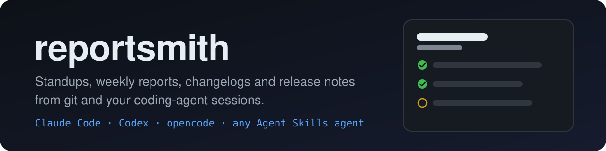

<p align="center">
  
</p>

<p align="center">
  <a href="https://github.com/mesubash/reportsmith/releases/latest"></a>
  <a href="https://github.com/mesubash/reportsmith/actions/workflows/test.yml"></a>
  <a href="LICENSE"></a>
  <a href="https://agentskills.io"></a>
  <a href="https://github.com/mesubash/reportsmith/blob/traffic/daily.csv"></a>
</p>

<p align="center">
  <a href="#install">Install</a> ·
  <a href="#example">Example</a> ·
  <a href="#use">Use</a> ·
  <a href="#configure">Configure</a> ·
  <a href="SECURITY.md">Privacy</a> ·
  <a href="CONTRIBUTING.md">Contribute</a>
</p>

**reportsmith** writes your standups, daily logs, weekly and monthly reports, changelogs and release notes. It reads what you actually did in a folder: your git commits **and the session logs your coding agents already keep**, so work that never reached a commit (incidents, reviews, server fixes, investigations) shows up too.

It is an open [Agent Skill](https://agentskills.io) for **Claude Code**, **Codex**, **opencode** and other AI coding agents. Reports come out in plain human wording, or in your own style, and can be published through any MCP server (Slack, Notion, Plane, Google Drive and more). No server, no database, no tracking: it runs when you ask, makes a report, and stops.

## Install

Pick your agent and copy one block.

### Claude Code

Run inside Claude Code:

```
/plugin marketplace add mesubash/reportsmith
```

```
/plugin install reportsmith@reportsmith
```

<details>
<summary>Without the plugin system</summary>

```sh
git clone https://github.com/mesubash/reportsmith.git ~/.reportsmith-src
ln -s ~/.reportsmith-src/skills/reportsmith ~/.claude/skills/reportsmith
```

</details>

### Codex

Uses Codex's built-in skill installer:

```sh
python3 ~/.codex/skills/.system/skill-installer/scripts/install-skill-from-github.py --repo mesubash/reportsmith --path skills/reportsmith --name reportsmith
```

### opencode

```sh
git clone https://github.com/mesubash/reportsmith.git ~/.reportsmith-src
mkdir -p ~/.config/opencode/skills
ln -s ~/.reportsmith-src/skills/reportsmith ~/.config/opencode/skills/reportsmith
```

opencode also loads skills from `~/.claude/skills/`, so if you installed it for Claude Code without the plugin system, opencode already has it.

### Other agents

Any agent that reads Agent Skills (`SKILL.md`), with the [skills CLI](https://skills.sh):

```sh
npx skills add mesubash/reportsmith
```

<details>
<summary>Agents without skill support</summary>

Clone the repo anywhere and add this line to your `AGENTS.md`:

```
For standups, status reports, changelogs or release notes, follow ~/.reportsmith-src/skills/reportsmith/SKILL.md
```

</details>

**Requirements:** `git` and `python3` (3.10 or newer, standard library only). `gh` is used for PRs and reviews if you have it.

### Try it

In any repo, ask your agent:

```
standup
```

## Example

You ask: *"standup for 2026-03-10, scope ~/work/app"*. That day the repo has two of your commits (one cherry-picked onto a second branch), a teammate's commit and a commit from the next day. You also had a Claude Code session that restarted a stuck worker and was then asked about a failed backup.

reportsmith writes:

```
Standup, 2026-03-10 (Tue)
Scope: app · Sources: git, Claude Code sessions

Yesterday
- Fixed duplicate card charges: a second charge can no longer start while the
  first is still unconfirmed (PAY-12, f0b6394).
- Added CSV export of invoices (INV-7, 7f61aa0).
- Restarted the stuck invoice queue worker on staging. 214 queued jobs drained
  and the queue is now empty.

To confirm
- Nightly backup failure: asked to look into it; the session does not say what
  was found or whether it was fixed.
```

The cherry-picked fix appears once, the teammate's commit and the next day's commit are left out, the restart shows up although it never reached git, and the backup question is not claimed as done. This exact case runs as an end-to-end eval in [`evals/standup-fixed-day`](evals/standup-fixed-day).

## Use

Ask in plain words:

| You say | You get |
|---|---|
| `standup` | yesterday and today, short |
| `what did I do yesterday in ~/work/api` | one day, one repo |
| `weekly report for my manager, last week` | outcomes and risks, no code detail |
| `monthly report for October, scope ~/clients/acme` | one client, rolled up by theme |
| `changelog since v1.2` / `release notes for v2.0` | user-facing changes from the tag range |
| `daily log, then post it to #eng` | publishes after you approve the preview |

Any period works: a day, a week, a month, a quarter, `last 10 days`, or `Nov 1 to Nov 15`.

## What it reads

```
scope: a folder, any period
sources                         render                     publish
───────                         ──────                     ───────
git (every repo in scope)  ─┐                          ┌─► file (default)
agent sessions in scope    ─┤                          ├─► any MCP tool: Slack, Notion,
  (Claude Code, Codex,      ├─► template + config  ─►  │    Plane, Google Drive, …
   opencode)                │    preview / confirm     │
agent memory (claude-mem)  ─┤                          ├─► webhook
PRs, tickets, notes        ─┘                          └─► shell command (e.g. gh release)
```

- **Folder scope.** `~/work` for your job, `~/side-project` for yourself, one folder per client. Every repo underneath is found automatically.
- **Honest.** Never invents items. Something an agent was asked to do counts as done only if a commit or the agent's final answer confirms it.
- **Reads like you wrote it.** Plain-wording rules are built in, and `style.sample` can point at your own past reports to copy your voice.
- **Private by default.** Secrets and IPs are removed before drafting, and nothing is published without your approval. See [SECURITY.md](SECURITY.md).

## Configure

Everything is optional. Copy [`config.example.yml`](skills/reportsmith/config.example.yml) to `~/.reportsmith/config.yml` (global) or `.reportsmith.yml` (one repo) and keep only what you change.

| You want | Set |
|---|---|
| Only count work in some folders | `scope.include`, `scope.exclude` |
| Reports that sound like you | `style.sample`, `style.voice`, `style.rules` |
| Your own report format | `templates_dir`, or `~/.reportsmith/templates/<kind>.md` |
| Reports saved in your own layout | `reports.<kind>.output`, e.g. `~/notes/{{yyyy}}/{{mm}}/{{dd}}.md` |
| Reports posted somewhere | `destinations` and `reports.<kind>.publish` ([how](skills/reportsmith/publishing.md)) |
| A new kind of report | add `templates/<kind>.md`, then ask for it by name |

<details>
<summary>Publishing destinations</summary>

Destinations are set once and used by name. Recipes exist for Slack, Notion, GitHub, Plane, Google Drive, Claude Docs and Discord; any other MCP server works through the [generic recipe](skills/reportsmith/destinations/_generic.md).

```yaml
destinations:
  team-chat: { via: mcp, server: slack, action: send message, channel: "#standup" }
  wiki:      { via: mcp, server: notion, action: create page, parent: "Weekly reports" }
  hook:      { via: webhook, url_env: REPORT_WEBHOOK }

reports:
  standup: { publish: [team-chat] }
  weekly:  { publish: [wiki] }
```

</details>

<details>
<summary>Run on a schedule (cron, CI)</summary>

Set `publish.confirm: false` in that run's config, and allow the tools it needs.

```sh
# Claude Code, every Friday at 17:00
0 17 * * 5  cd ~/work && claude -p "weekly report for this week, publish" --allowedTools "Bash(git:*)" "Bash(python3:*)" "Bash(gh:*)" "mcp__slack"
```

```sh
# Codex, every Friday at 17:00
0 17 * * 5  codex exec -C ~/work "weekly report for this week, publish"
```

In unattended runs reportsmith never asks: if something is missing (scope, range, an MCP server), it stops and says why.

</details>

<details>
<summary>Config stability</summary>

`version: 1` is the current config format. Within version 1, a key never changes meaning or disappears; a renamed key keeps working under its old name, with a note, until the next format version. Anything that breaks existing configs bumps `version` and is listed in the [changelog](CHANGELOG.md).

</details>

## Not included, on purpose

Activity or time tracking, productivity metrics, a stored history of your work, a hosted service.

## Contributing

New destination recipes (Jira, Confluence, Linear) and session readers (Cursor) are the most useful contributions. See [CONTRIBUTING.md](CONTRIBUTING.md) and the [open issues](https://github.com/mesubash/reportsmith/issues).

## Credits

Writing rules adapted from [Wikipedia: Signs of AI writing](https://en.wikipedia.org/wiki/Wikipedia:Signs_of_AI_writing).

## License

[MIT](LICENSE)
